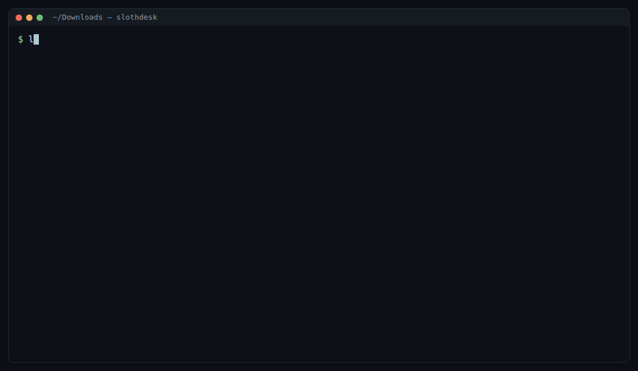

# slothdesk 🦥

Sort a messy Downloads folder without touching it yourself.

A local **Gemma 4** looks at every file on your laptop and gives it a real name and a folder. Then it writes you a two-minute note: what to deal with first, what's coming up, what should not be sitting in Downloads, and what you can delete.

Everything runs on your machine through Ollama. Secrets aren't even opened.



```
$ slothdesk scan ~/Downloads
[ 1/23] download (3).pdf
      -> sorted/finance/2026-09-15-electricity-bill-october-2026.pdf
[ 5/23] LOCKED rootkey.csv
      -> sorted/_lock-this-up/rootkey.csv
[15/23] Screenshot_2026-10-21_23-14-07.png
      -> sorted/code/2026-10-21-rust-compilation-error-message.png
[21/23] LOCKED Screenshot_2026-10-20_00-12-44.png
      -> sorted/_lock-this-up/2026-10-20-secret-on-screen.png
...
planned 23 files in 137s. 4 secret, 8 private, 2 duplicates. Nothing has moved yet.

$ slothdesk apply ~/Downloads     # moves them, writes an undo journal
$ slothdesk undo ~/Downloads      # puts every file back
$ slothdesk digest ~/Downloads    # the two-minute note
```

## How it decides what a model may see

Every file goes through a gate before any model is called:

| Level | How it's detected | Local Gemma | Note writer |
|---|---|---|---|
| **secret** | name (`*.pem`, `id_rsa`, `rootkey.csv`, `*recovery-codes*`, `.env`) or a signature in the first 64 KB (private key header, `AKIA…`, `ghp_…`, a block of recovery codes) | never opens it | the file name and "cloud credentials" |
| **secret on screen** | Gemma sees a password, seed phrase, backup codes or a key in a screenshot | saw it once, locally; never again | "secret shown inside the file" |
| **private** | name (bank, tax, PAN, Aadhaar, payslip, resume, challan…), or Gemma spots it, or the text has a PAN, Aadhaar-like number, IFSC, PNR | reads it | the new name, a category, dates and to-dos, no summary |
| **ordinary** | everything else | reads it | the new name and a one-line summary |

The last column is what the note writer gets. By default that's the same local Gemma, but the boundary is built as if it were a stranger, so you can swap in a cloud model (see below) without changing what it can learn.

Everything handed to the writer goes through a scrubber that removes emails, links, PAN-shaped ids, amounts and any token with four or more digits (years and ISO dates survive). Original file names are never sent, because names like `<your PAN>_AIS.json` are themselves personal.

## The note

Code writes the parts that have to be exact: upcoming dates in order, files to lock up, duplicates and old installers, folder counts. The model does the judgment: it picks the three things to deal with first, and before it picks, it checks with one tool:

```
ask_local(file_id, question)
```

```
  ask_local f6: Has the traffic fine mentioned in this file been paid?
    -> The status of the traffic fine is listed as UNPAID. Payment is due by the date of November 5, 2026.
```

The tool opens the file locally, answers in at most two sentences, and scrubs the answer. Secret files refuse. Every request, tool call and answer is written to `.slothdesk/outbound/`, and `--dry-run` writes the request without running it. Each run's tokens and time go to `.slothdesk/costs.jsonl`.

A full note for the demo pile is in [docs/example-note.md](docs/example-note.md).

### Optional: a cloud writer

`slothdesk digest <dir> --cloud` sends the same scrubbed request to Ultramarine (`ultramarine-1-flash`, Paper Instruments) through the OpenAI SDK and logs what the run cost. The files still never leave; the cloud model gets the list and can only learn more through `ask_local`. This path is wired up but I haven't run it against the live API yet (Paper Instruments has a waitlist).

## Install

Needs Node 20+, [Ollama](https://ollama.com), `pdftotext` (poppler) and `ffmpeg`.

```bash
ollama pull gemma4:e4b
git clone https://github.com/KunalSiyag/slothdesk && cd slothdesk && npm install && npm link

slothdesk scan ~/Downloads          # local only, nothing moves
slothdesk plan ~/Downloads          # read the plan
slothdesk apply ~/Downloads

slothdesk digest ~/Downloads        # the note, written locally
```

Try it on fake files first: `npm run demo` builds a made-up messy folder in `demo/pile` (bills, a bank statement, a challan, fake keys and recovery codes, screenshots), using headless Chrome.

| Setting | Default |
|---|---|
| `SLOTHDESK_MODEL` | `gemma4:e4b` (any Ollama vision model works; `gemma3:4b` is faster) |
| `SLOTHDESK_DIGEST_MODEL` | same as `SLOTHDESK_MODEL` |
| `OLLAMA_HOST` | `http://localhost:11434` |
| `PAPERINSTRUMENTS_API_KEY` | only for `digest --cloud` |

## Numbers

On a laptop RTX 3050 (4 GB VRAM) with `gemma4:e4b`:

- 69 real screenshots: 7.8 minutes, about 6.8 s each, no failures. Two were flagged as secrets on screen.
- The 23-file demo pile: 137 s to scan, about 58 s to write the note with three `ask_local` checks.

Gemma 4 thinks before answering by default. For naming a screenshot that took 28 s and 615 tokens; with `think: false` it's about 6 s and 40 tokens, with names just as good.

## What it won't do

- Delete anything. Duplicates go to `sorted/_duplicates/` and you decide.
- Move a file that changed since the scan, or overwrite one that exists.
- Look inside sub-folders. It sorts the top level of one folder.
- Leave secrets where they are and pretend that's fine. `_lock-this-up/` is a nag, not a vault: move those files into a password manager or an encrypted folder.

## License

MIT
